# 毕业设计流程图集

日期：2026-10-26  
图集版本：V1.0  
依据：主方案 V0.9、详细技术路线 V1.1；本次仅将既有设计可视化。所有图为拟议研究流程，不表示正式系统或实验已经完成。

[打开离线图集](index.html)

## 图 1 总体技术路线

真实轨迹与仿真视频分别提供证据。在线避撞只使用已可用观测；仿真真值进入训练标签与独立评测。

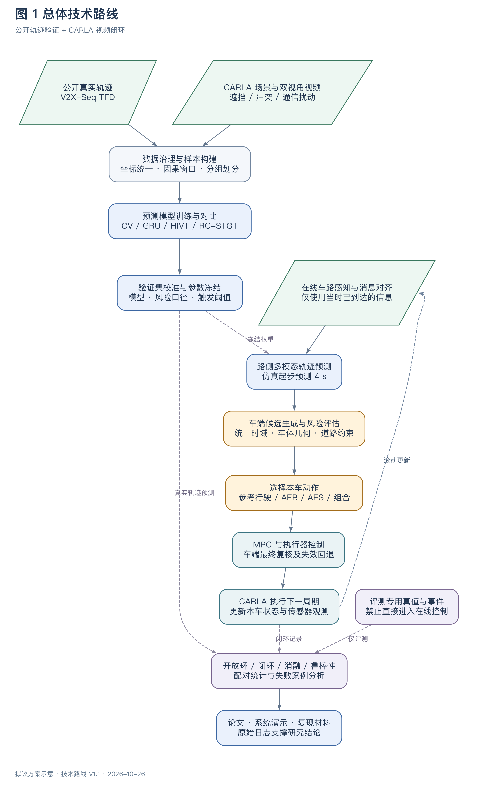

[SVG 矢量图](images/01_overall.svg) · [PNG 图片](images/01_overall.png) · [Mermaid 源码](source/01_overall.mmd) · [DOT 源码](source/01_overall.dot)

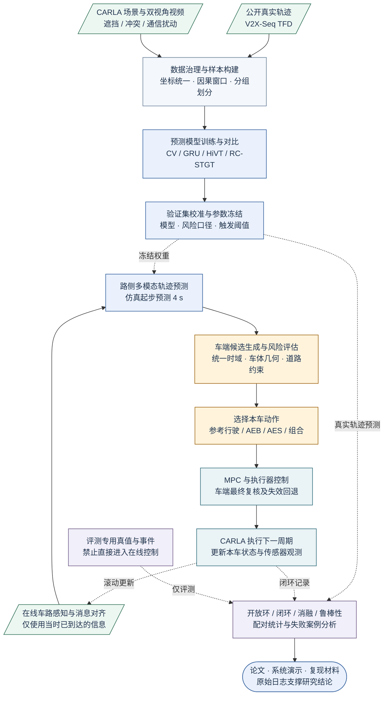

依据：技术路线 1、4、15、16 节；研究方案 3、9、11 节。

## 图 2 车路感知与通信流程

V2I 上传与 I2V 下发分别模拟时延。目标暂时失联时保留有限风险记忆；本地回退无法凭空恢复从未观测到的盲区目标。

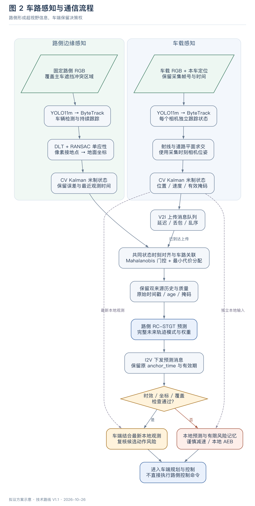

[SVG 矢量图](images/02_cooperative_perception.svg) · [PNG 图片](images/02_cooperative_perception.png) · [Mermaid 源码](source/02_cooperative_perception.mmd) · [DOT 源码](source/02_cooperative_perception.dot)

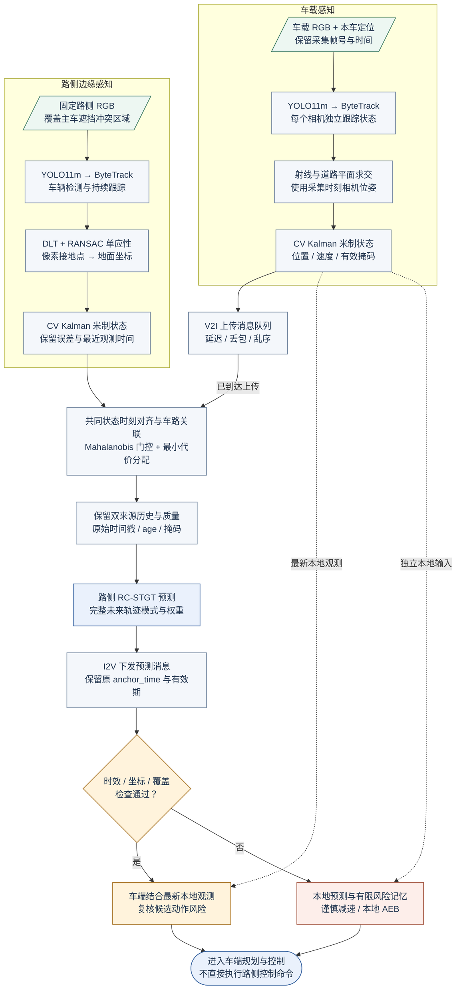

依据：技术路线 2、6、7、21.2–21.5 节。

## 图 3 RC-STGT 多模态预测结构

形状以仿真起步配置表示，N 为可变车辆数。RC-STGT 为本项目工作名；HiVT 保留为独立基线。未来真值只监督训练损失。

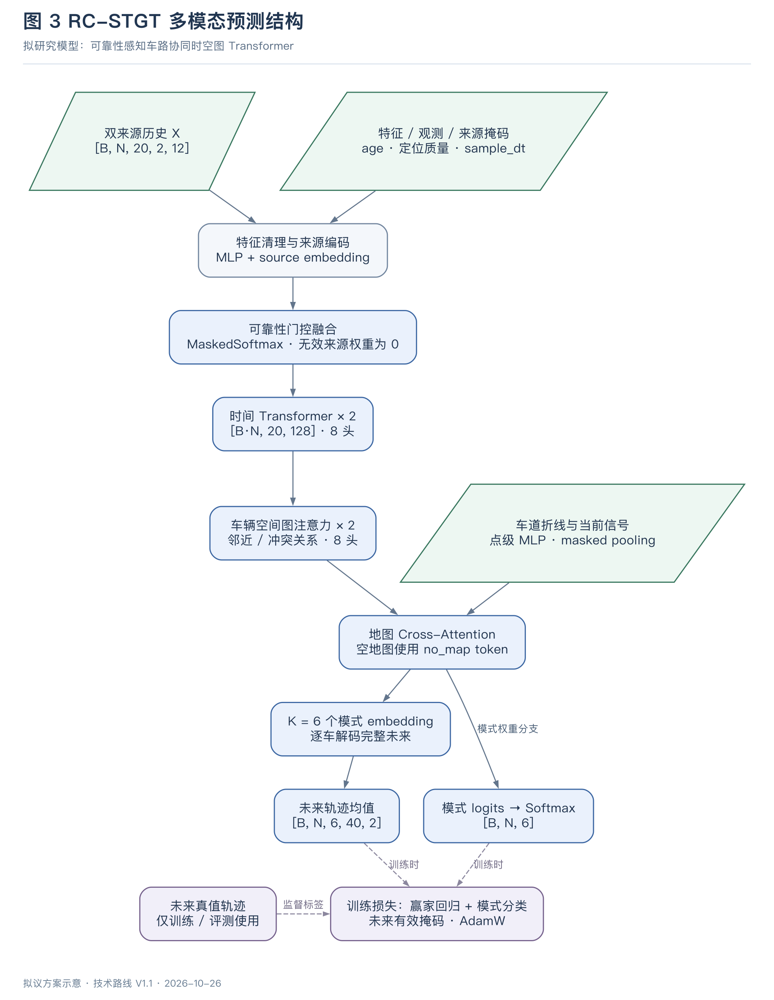

[SVG 矢量图](images/03_transformer.svg) · [PNG 图片](images/03_transformer.png) · [Mermaid 源码](source/03_transformer.mmd) · [DOT 源码](source/03_transformer.dot)

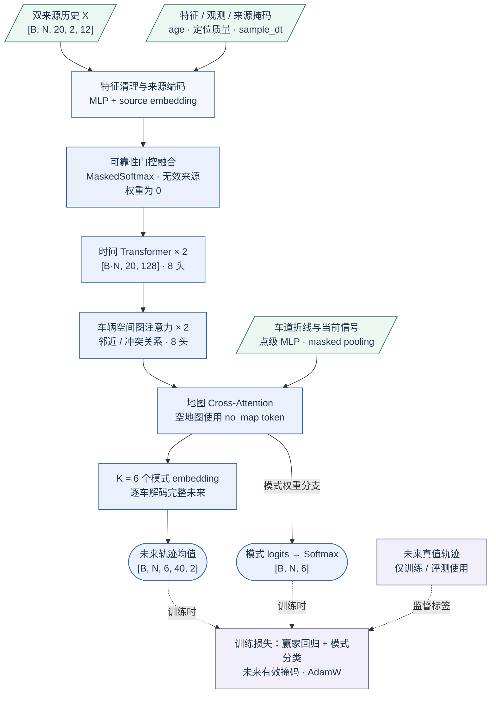

依据：技术路线 8、9、21.6 节。

## 图 4 碰撞风险与主动避撞决策

不同动作使用同一有效时域。离散车对风险按模式权重求和，多车 max/sum 为评分；不能把它们当作已校准的真实联合概率。

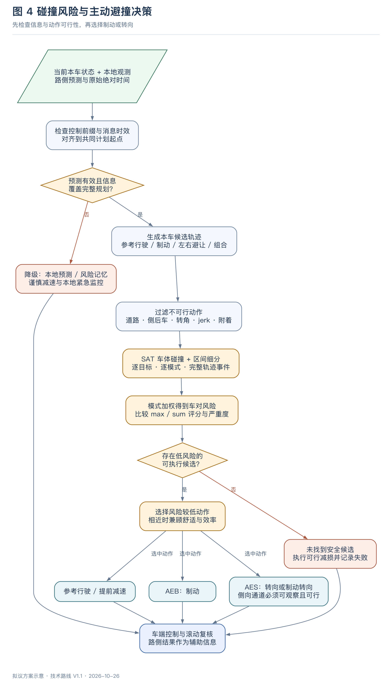

[SVG 矢量图](images/04_risk_decision.svg) · [PNG 图片](images/04_risk_decision.png) · [Mermaid 源码](source/04_risk_decision.mmd) · [DOT 源码](source/04_risk_decision.dot)

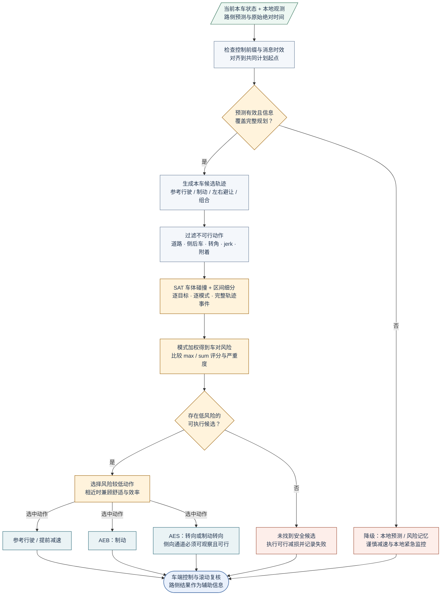

依据：技术路线 7、10、11、21.7–21.8 节。

## 图 5 MPC 跟踪与失效回退闭环

六状态为 [x,y,ψ,v,a,δ]，控制为 [jerk,转角速率]。外层截止、节点间约束和求解后风险复核均需实现；MPC 本身不保证必然避撞。

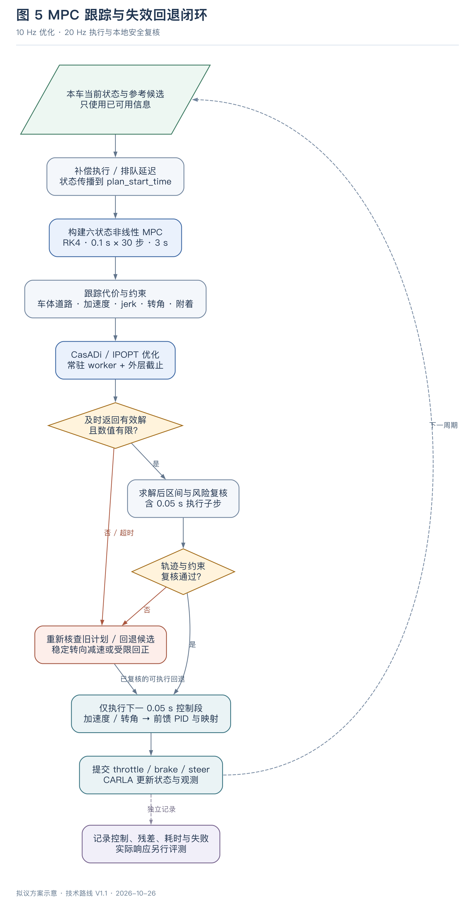

[SVG 矢量图](images/05_mpc.svg) · [PNG 图片](images/05_mpc.png) · [Mermaid 源码](source/05_mpc.mmd) · [DOT 源码](source/05_mpc.dot)

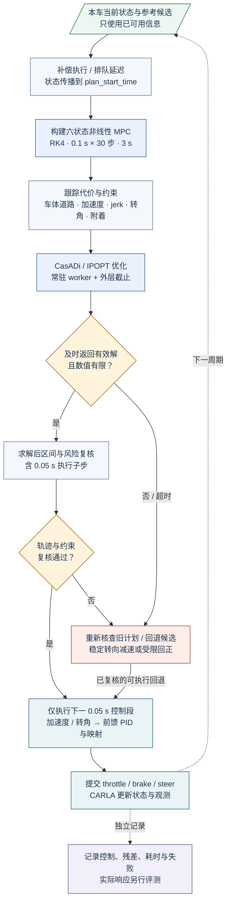

依据：技术路线 12、21.9、22.4 节。

## 图 6 实现测试与研究验证流程

公开日志用于轨迹预测与声明的风险代理，控制收益由仿真配对实验验证。指标、失败运行和统计区间均保存，不能用单次视频代替证据。

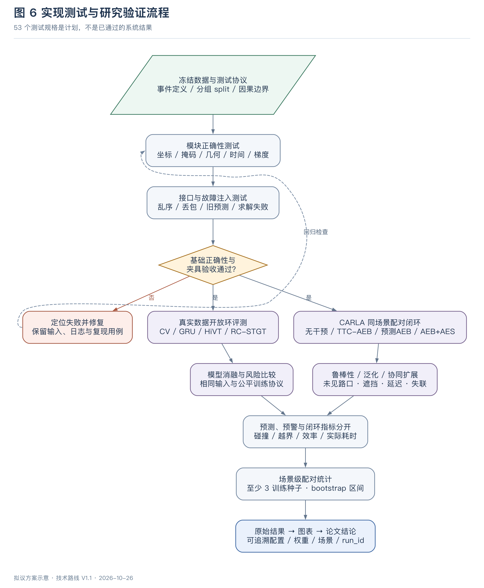

[SVG 矢量图](images/06_testing.svg) · [PNG 图片](images/06_testing.png) · [Mermaid 源码](source/06_testing.mmd) · [DOT 源码](source/06_testing.dot)

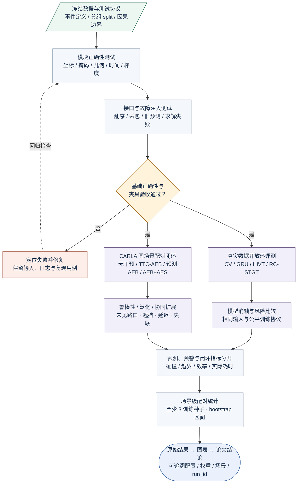

依据：技术路线 4、15、16、22、23 节。

## 使用与再生成

论文优先插入 SVG；不支持 SVG 的编辑器可使用 PNG。Mermaid 便于在 Markdown 中修改；DOT 是本次导出排版源码。两类源码来自同一 graphs.json 节点关系，布局可能随渲染器变化。

再生成：在安装 @viz-js/viz 与 sharp 的 Node.js 环境运行图集目录下 generate.cjs；可通过 FLOWCHART_NODE_MODULES 指定依赖目录。

本次仅检查图形源码、布局和导出，不重新运行 53 个算法/系统测试，也不产生预测或碰撞率结果。
