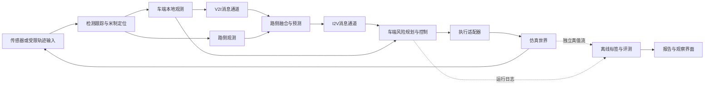

# OccluActiSafe 工程架构与文件结构设计

日期：2026年10月26日。

**状态：实施设计。** N01/N02 已由用户验收；N03 的 TFD 适配和审计代码已实施，但真实数据获取受阻，测试与状态见节点计划；后续节点的源码、配置、命令和前端仍为拟建内容。用户明确授权具体节点后，才在该节点范围内创建文件、安装依赖或运行任务，完成后停止等待验收。项目历史统一由Git管理，不建立备份目录或人工变更日志。

本文负责工程组织、文件职责、接口边界和运行流程；逐项授权、实施顺序、验收与结果回填统一见 [项目节点实施与验收计划](项目节点实施与验收计划.md)。算法公式和详细测试依据见 [详细技术路线](详细技术路线.md)，研究范围见 [研究方案](毕业设计研究方案.md)，双向消息见 [通信方案](车路通信方案.md)，核心成品与鬼探头范围见 [专题方案](算法成品与盲区鬼探头方案.md)。资料发生冲突时先核对并同步修订，不能按任意一份旧示例直接编码。

## 1 交付目标与总体方案

核心交付是可无界面运行的 `occluactisafe` Python算法包，附训练、评测、配置和可复核运行材料。采用单仓库、模块化算法包、独立仿真桥接和可选展示层，不把每个算法拆成一个网络服务。

| 层次 | 主要职责 | 必须守住的边界 |
| --- | --- | --- |
| 核心算法 | 观测融合、盲区状态、轨迹预测、动作风险、AEB/AES、控制与回退 | 输入为合法可得的数据对象，不依赖页面、CARLA World或评测真值 |
| 仿真与输入适配 | 传感器、坐标转换、仿真时钟、场景重建、控制提交 | 只有适配层持有CARLA句柄；观测与真值分两条输出通路 |
| 训练与实验评测 | 数据划分、标签、模型对比、配对闭环、统计与图表 | 可读取监督/评测真值；不能把真值反送在线决策 |
| 观察展示 | 只读状态查询、回放、风险解释、实验检索和报告 | 不启停实验、不改运行配置、不推进tick，断开页面不影响算法 |

路侧 `RoadsideEdge` 接收自身观测和经过V2I到达的车端观测，生成协同预测；车端 `VehicleDecisionCore` 接收本地观测和经过I2V到达的路侧消息，复核风险并决定本车动作。同机运行也保留上述消息边界。



最小闭环先用受限轨迹、CV预测、几何风险和AEB；随后接入视频感知、学习型预测、AES/MPC与故障回退，最后扩展两车意图协调。盲区来车和行人/骑行者鬼探头属于最终必做范围。

## 2 技术栈与环境边界

下表为总体技术设计；N02 已通过 uv 锁定并在本机 Python 3.10/3.11 验证 NumPy 和 PyYAML，其他依赖仍不代表已安装或完成兼容性验证。

| 领域 | 拟采用技术 | 实现方式 |
| --- | --- | --- |
| 核心语言与工程 | 主开发/训练Python 3.11、共享包兼容Python 3.10、`src`布局、`pyproject.toml`、uv | 类型标注、依赖分组、锁文件；命令入口调用包内逻辑 |
| 数据与配置 | NumPy、pandas、PyArrow/Parquet、YAML | 原始数据只读，统一中间表；小夹具先用JSON/CSV |
| 对外契约与内部对象 | Pydantic 2、dataclass、NumPy数组 | 配置/消息入口严格校验；内部计算使用明确类型与掩码，避免反复序列化 |
| 检测与跟踪 | YOLO26、YOLOv8、YOLO11及按需加入的其他模型；ByteTrack | 检测器注册表与框架适配器，实验后选择；跟踪器按相机独立维护 |
| 定位与融合 | OpenCV、SciPy、NumPy | DLT/RANSAC、射线地面定位、CV Kalman、Mahalanobis门控与最小代价分配 |
| 轨迹预测 | PyTorch；CV、GRU、官方HiVT适配和RC-STGT | 统一预测接口；RC-STGT先用原生张量/注意力实现，PyG仅在确有需要时引入 |
| 风险与校准 | NumPy、按需使用scikit-learn | 分类几何、模式事件评分、专用风险校准集拟合；模型验证与测试隔离 |
| 规划与控制 | 候选采样、Frenet/S曲线、CasADi + IPOPT、RK4、PID | 先筛选候选再跟踪优化，求解后复核，失败进入有约束的回退 |
| 通信原型 | `heapq`、进程间消息、Python socket/UDP | 双向信道独立；JSON调试，后续有带宽需求再引入Protobuf |
| 仿真 | CARLA服务端与匹配的Python客户端 | 唯一tick所有者；真实设备和实车不属于当前交付 |
| 实验与存储 | JSONL、CSV、Parquet、文件清单；后期SQLite索引 | 每次run保存配置/哈希/状态；先用文件，不引入分布式消息队列或集群调度 |
| 展示 | FastAPI、Vue 3、TypeScript、Vite、ECharts | 只读REST查询/回放/报告，按需读取视频/轨迹/指标；状态推送按需另议，不扩大N31范围 |
| 质量检查 | pytest、Ruff、静态类型检查按接口逐步接入 | 先CPU纯函数与因果边界，再GPU/CARLA；缺依赖的跳过明确列出 |

### 2.1 核心、训练与CARLA分别配置环境

1. **核心/CPU环境**：验证配置、通信、CV、几何和状态机，不要求GPU、CARLA或前端。导入核心包不能自动下载权重、初始化CUDA或连接服务器。
2. **训练/推理环境**：在服务器安装匹配硬件的PyTorch和视觉依赖，按CPU、ML、感知、控制、API、开发工具分组。核心环境锁文件记录验证后的依赖；旧HiVT如有冲突，在独立环境运行后转换到同一结果契约，不硬塞进主环境。
3. **CARLA桥接环境**：先核查0.9.15是否适配服务器；该版本可从Python 3.10桥接环境起步，按实际OS/wheel选择，不能假定可直接装进Python 3.11。独立环境通过消息协议接入核心，服务端与客户端版本不一致时拒绝正式实验。
4. **展示环境**：Node依赖与Python API依赖单独锁定。界面是后续展示模块，首批算法开发不依赖前端安装成功。

共享包采用单包兼容方案：根包元数据最低Python为3.10，源码保持3.10可解析；开发/训练默认3.11。CARLA桥接在3.10环境安装同一包的轻依赖，ML/感知/控制/API按需分组，根 `__init__.py`不导入重依赖。不得把根包声明成仅支持3.11后再依赖extras或`--no-deps`绕过版本约束。两个环境分别锁定依赖；验收须检查双环境安装/导入及同一组JSON黄金消息的往返一致性。

RTX 5060 Ti在NVIDIA官方表中为计算能力12.0；PyTorch 2.7的Blackwell/CUDA 12.8支持说明可作为兼容性起点，但不据此固定旧版本。正式选择当时受支持的构建，检查CUDA张量、训练前后向、实际模型及所用扩展，再记录驱动、构建、设备能力和权重哈希。`torch.cuda.is_available()`单项通过不能代替整套训练栈验证。[NVIDIA设备表](https://developer.nvidia.com/cuda/gpus)、[PyTorch支持说明](https://pytorch.org/blog/pytorch-2-7/)

CARLA 0.9.15实际wheel清单与官方API用于核对Python支持和客户端/服务端版本。若服务器不能使用该候选版本，先记录兼容性问题并修订环境配置，再冻结另一经验证版本，不混用安装教程。[wheel清单](https://pypi.org/project/carla/0.9.15/)、[安装说明](https://carla.readthedocs.io/en/0.9.15/start_quickstart/)、[Client API](https://carla.readthedocs.io/en/0.9.15/python_api/#carla.Client)

FastAPI不承担YOLO、Transformer或MPC计算；计算由获准Python入口和独立worker组织，N31 API只读取既有run、状态和回放，不提交运行/训练请求。[并发与并行说明](https://fastapi.tiangolo.com/async/)。Vue/TypeScript、Vite与ECharts的具体版本在展示阶段冻结。[Vue](https://vuejs.org/guide/typescript/overview.html)、[Vite](https://vite.dev/guide/)、[ECharts](https://echarts.apache.org/handbook/en/basics/import/)

## 3 拟建文件结构

**目录树是完整设计清单，不表示其中全部文件已经存在。** N01/N02 工程与公共契约见节点计划和[数据契约字典](N02数据契约字典.md)，N03 数据审计实现见[数据审计说明](N03数据审计说明.md)；其余按节点逐步创建，避免一次堆出大量无行为的空壳。树中的 `[现有]` 标记保留作原设计时点的提示，实际状态以仓库和节点计划为准。

```text
OccluActiSafe/
├── AGENTS.md / README.md                  [现有] 协作约定与入口
├── pyproject.toml                        核心包、依赖分组、命令与检查配置
├── uv.lock                               经目标环境验证后的依赖锁定
├── configs/
│   ├── base.yaml                         时钟、路径、种子、运行默认值
│   ├── data/{tfd,carla}.yaml              数据适配与划分
│   ├── perception/{detectors,tracking}.yaml  候选注册与跟踪参数
│   ├── models/{cv,gru,hivt,rc_stgt}.yaml   预测模型配置
│   ├── communication/{clean,impaired}.yaml 双向信道、过期、容量与故障
│   ├── control/{vehicle,mpc,fallback}.yaml 车辆标定、求解与回退
│   ├── scenarios/                        盲区来车、鬼探头、无人对照
│   └── experiments/                      默认任务、检测器/预测/闭环/消融矩阵
├── src/occluactisafe/
│   ├── __init__.py / __main__.py / cli.py  包与命令入口
│   ├── common/
│   │   ├── schemas.py                    数据对象、枚举与基础验证
│   │   ├── config.py                     配置加载、合并、路径解析
│   │   ├── clock.py                      仿真钟/计时器与任务时间
│   │   ├── coordinates.py                坐标、单位和参考点转换
│   │   ├── run_manifest.py               运行清单、哈希和随机种子
│   │   └── errors.py                     可追溯错误与失败状态
│   ├── core/
│   │   ├── interfaces.py                 模块Protocol与输入输出边界
│   │   ├── pipeline.py                   根据冻结配置组装依赖
│   │   ├── roadside_edge.py              路侧融合、预测与消息生成
│   │   ├── vehicle_agent.py              VehicleDecisionCore.step
│   │   ├── safety_monitor.py             质量/覆盖/截止监控与回退触发
│   │   └── runtime.py                    非CARLA专用的调度与生命周期
│   ├── data/
│   │   ├── adapters/{tfd,carla}.py        数据源转统一表
│   │   ├── quality.py / split.py         质量报告与分组划分
│   │   ├── windows.py                    因果历史窗口与掩码
│   │   └── labels.py                     离线事件/代理/反事实标签
│   ├── perception/
│   │   ├── base.py / registry.py         Detector协议与配置注册
│   │   ├── detector.py                   推理统一调度与输出归一
│   │   ├── adapters/ultralytics.py        三类YOLO的框架适配
│   │   ├── tracker.py                    每相机ByteTrack生命周期
│   │   ├── calibration.py / projection.py 固定/移动相机地面定位
│   │   ├── visibility.py                 观测条件下的遮挡/未知区域
│   │   └── participants.py               类别、尺寸先验与骑行者关联
│   ├── fusion/
│   │   ├── state_filter.py               CV Kalman与因果外推
│   │   ├── association.py                跨视角门控和线性分配
│   │   └── history.py                    多来源缓存与风险记忆
│   ├── communication/
│   │   ├── protocol.py / validation.py   消息封装、接收验证与有效期
│   │   ├── channel.py                    双向最小堆、容量排队和扰动
│   │   ├── transport.py                  内存/进程间传输接口
│   │   └── udp.py / fragmentation.py     后续UDP、分片、限速和重组
│   ├── prediction/
│   │   ├── base.py / dataset.py          预测协议、张量与采样
│   │   ├── source_fusion.py / temporal.py 来源门控与时间编码
│   │   ├── spatial.py / map_encoder.py   交互图与地图编码
│   │   ├── rc_stgt.py                    组装编码器与多模式解码
│   │   ├── baselines/{cv,gru,hivt_adapter}.py
│   │   └── losses.py / train.py / evaluate.py
│   ├── risk/
│   │   ├── obb.py / occupancy.py         车辆SAT与按类别占用几何
│   │   ├── coverage.py                   时间窗、年龄与目标覆盖
│   │   └── multimodal.py / calibration.py 动作条件事件评分与校准
│   ├── planning/
│   │   ├── candidates.py / braking.py    保持、制动与S曲线候选
│   │   ├── frenet.py / lateral.py        五次多项式转向及道路约束
│   │   ├── decision.py                   策略排序、滞回与状态机
│   │   └── cooperation.py                后续两车提议/确认/超时协议
│   ├── control/
│   │   ├── vehicle_model.py              六状态自行车模型与RK4
│   │   ├── executor.py                   非阻塞求解调度、接收与执行检查
│   │   ├── mpc.py / worker.py            CasADi/IPOPT与外层截止
│   │   ├── validation.py                 解后区间、道路和车体复核
│   │   └── actuator.py / fallback.py     标定映射、PID与平稳回退
│   ├── simulation/
│   │   ├── carla_client.py               版本校验与连接
│   │   ├── scenarios.py / sensors.py     场景与传感器生命周期
│   │   ├── observation_adapter.py        按输入模式构造合法观测
│   │   ├── runner.py                     唯一CARLA tick所有者
│   │   ├── actuator.py                   向CARLA提交复核后的请求
│   │   └── truth_logger.py               单向输出离线评测真值
│   ├── evaluation/
│   │   ├── truth_store.py                离线真值与标签读取
│   │   ├── detection_metrics.py          三类检测器统一评分
│   │   ├── prediction_metrics.py         ADE/FDE等预测指标
│   │   ├── episode_metrics.py            碰撞、越界、延迟与干预
│   │   └── paired.py / reporting.py      配对校验、统计与报告
│   ├── experiments/
│   │   ├── detector_matrix.py            检测器候选遍历
│   │   ├── prediction_matrix.py          预测对比与消融
│   │   ├── closedloop_matrix.py          场景×策略×扰动运行
│   │   ├── run_store.py                  配置/日志/状态与产物索引
│   │   └── selection.py                  只依据验证集选择配置
│   └── api/
│       ├── app.py / schemas.py           观察API与响应契约
│       └── routes/{experiments,replay}.py 只读运行查询、状态、回放与报告
├── environments/carla_bridge/
│   └── pyproject.toml / uv.lock           独立Python与CARLA依赖
├── scripts/
│   ├── check_docs.py                      [现有] 文档静态核查
│   ├── check_environment.py / smoke_check.py / run_analytic_demo.py
│   ├── prepare_data.py / discover_occluded_junction.py
│   ├── evaluate_detectors.py / train_detector.py
│   ├── train_prediction.py / evaluate_prediction.py
│   ├── calibrate_vehicle.py / run_occluded_junction.py
│   └── run_matrix.py / summarize.py       薄包装，调用包内实现
├── tests/
│   ├── fixtures/                         小型合成输入，可入Git
│   ├── unit/                             时间/坐标/几何/状态机
│   ├── integration/                      无CARLA模块链与进程边界
│   ├── gpu/                              模型前后向与性能
│   └── carla/                            场景、执行器与视频闭环
├── web/                                  后期观察界面
│   ├── package.json / pnpm-lock.yaml
│   └── src/{api,views,components,stores,types}/
├── data/{raw,processed,splits}/           本地数据，不纳入普通Git
├── artifacts/                            权重、运行日志与图表，不纳入普通Git
├── docs/                                 [现有] 当前研究和设计文档
└── thesis/                               [现有] 保留，后续论文材料
```

普通算法模块目录均拟包含 `__init__.py`，树中省略。花括号用于压缩展示多个独立文件，不是实际文件名。新增模型适配器遵循 `perception/adapters/` 契约；不为每个YOLO版本复制整套流水线。`simulation/`的桥接进程运行在独立环境，只安装公共协议/桥接所需的轻依赖，不拉入训练栈。

## 4 依赖方向与核心入口

### 4.1 代码依赖方向

- `common`是基础；算法模块依赖公共契约，不依赖CARLA、评测真值或前端。
- `core`只组装感知/融合/预测/风险/规划/控制接口；`core/runtime.py`提供通用调度，`simulation/runner.py`才负责实际tick。
- `simulation`、`api`、`experiments`位于外层，可以调用核心；核心不得反向导入这些层。`data/labels.py`、`evaluation`属于离线路径，在线核心不导入。
- `cli.py`与 `scripts/`只组织明确的默认任务、参数覆盖、配置校验与调用；脚本支持IDE直接运行，命令行是可选覆盖方式；业务逻辑均在包内。训练、离线评测和在线决策复用同一算法实现。
- 模型、求解器和CARLA使用延迟加载。依赖缺失返回明确错误，不能自动改用虚假输出或随机预测。

### 4.2 CARLA桥接与主进程握手

纯算法/解析阶段可以同进程组装；CARLA阶段主算法进程与桥接进程按独立环境运行。`core/runtime.py`负责算法周期编排，`simulation/runner.py`是唯一调用 `world.tick()` 的位置，二者不能各自推进仿真。

桥接输出带 `run_id/episode_id/generation/frame_id/sim_time` 的TickEvent与合法观测流；真值另写日志，不混入事件交给核心。主进程发带目标帧与有效期的控制/AdvanceRequest，桥接验证会话和帧顺序后提交控制并推进下一tick，返回帧确认。重复/倒序推进、跨episode请求和过期控制被拒绝。

相机回调按真实frame_id缓存并有容量/等待上限，不用“最近一帧”冒充指定时刻观测。桥接失联、握手超时或主进程故障由预声明的安全退出流程处理，结束后清理actor并恢复设置；不能由页面刷新或网络重试触发额外tick。跨进程等待的墙钟时间仍按第7节映射为处理/可用延迟。

### 4.3 对外核心接口

以下是文档接口约定，不是本轮创建的实现：

```text
RoadsideEdge.step(now, roadside_observations, received_v2i,
                  known_map, health) -> PredictionMessage | NoResult

VehicleDecisionCore.step(now, ego_state, local_tracks,
                         received_roadside_messages, known_map,
                         visibility_state, health) -> DecisionBundle

ControlExecutor.step(now, decision, ego_state,
                     current_safety_context) -> ControlResult
```

`VehicleDecisionCore.step`输出模式、动作参考、风险上下文和控制求解请求，不等待MPC完成。`ControlExecutor`在20Hz周期非阻塞地接收worker结果、检查请求/状态/有效期、复核优化后轨迹与当前安全约束，再决定采用、短时沿用或回退。`current_safety_context`仅由当时合法可用的观测/消息构建，不含仿真真值。

冻结配置和算法实例在构造阶段注入；`step`不从全局变量取隐藏输入。`NoResult`包含原因、任务标识和时间，不意味着目标消失。只有 `ControlExecutor → 仿真执行适配器`拥有控制提交权，页面、路侧和评测模块没有直接写执行器的路径。

## 5 数据契约与因果约束

### 5.1 跨模块对象

| 对象 | 关键内容 | 输入/输出约束 |
| --- | --- | --- |
| SensorFrame / PixelTrackFrame | run、episode、sensor、采集时间、帧号、图像/框、类别、score、局部track_id | 框在原图坐标；ID按来源/会话/相机隔离，空检测也保留帧 |
| ObservationPacket / TrackState | 地图/坐标版本、状态参考点、x/y/vx/vy/yaw、尺寸/质量、原始观测时间、外推状态时间与掩码 | 米、秒、弧度；不把未知速度和真实零速度混同；记录类别与尺寸来源 |
| SceneTensor | 双来源历史、动态/静态特征、地图与掩码、预测锚点和坐标变换 | 仿真起步X为[B,N,20,2,12]；监督未来单独存储，不进入forward |
| PredictionBundle | [B,N,K,T,2]轨迹、[B,N,K]权重、有效掩码、anchor/future_times、输入截止与模型哈希 | 起步K=6、T=40；权重有限/非负/归一，输出转回统一地图坐标 |
| VisibilityGrid / OcclusionRiskRegion | 几何可视/遮挡/未知区域、参考时间、来源与质量 | 与已观测目标分开；未知区域不能伪装成精确隐藏目标 |
| CandidateSet / RiskTable | 动作、可执行参考轨迹、共同绝对时域、事件评分、覆盖与约束拒绝原因 | 风险绑定动作、参考策略和时域；边际评分/上界与联合概率区分 |
| DecisionBundle | Normal/Caution/AEB/AES/Degraded/Recovery、动作原因、参考轨迹、有效风险/约束上下文、请求ID、执行起点与有效期 | 核心输出高层决策和求解请求，不阻塞等待MPC |
| ControlResult | 请求/计划ID、求解状态、解后复核、当前控制请求、有效期与回退原因 | 执行器只接受当前有效且复核通过的请求；失败不能返回“成功”控制 |
| EvaluationRecord | 真值事件、参考策略、反事实分支、指标与运行标识 | 只供标签/评测读取，不传入在线step |

JSON序列化不使用NaN/Infinity；缺失数值使用可空字段与有效掩码，张量阶段按掩码处理。航向、几何中心与后轴中心的变换只在统一坐标模块定义，起步采用右手平面 `X=x_CARLA, Y=-y_CARLA` 并同步转换速度、yaw和地图。

`risk_kind`至少区分未校准事件评分、校准后的事件概率和未知区域保守约束。未执行概率校准时，不把确定性SAT或模式权重和直接标成可信碰撞概率。

### 5.2 内部对象与传输消息分开

内部对象不直接等同于网络包。`ObservationMessage`和`PredictionMessage`增加 `schema_version/source_id/session_id/sequence/map_id/map_version/coordinate_frame_id/frame_id` 等字段；frame_id是采集/仿真帧序号，coordinate_frame_id才标识坐标系，轴向/单位/参考点单独定义。接收端用ReceivedMessage附加本地元数据；发送者不能伪造到达时刻。

| 时间字段 | 本设计中的唯一语义 |
| --- | --- |
| observation_time / last_seen_time | 真实采集或最近真实观测时刻，不因外推而更新 |
| source_available_time | 本地感知/预处理完成，可交付后续模块的时刻；消除旧稿available_time的歧义 |
| state_time | 因果滤波/外推状态所对应的时刻 |
| anchor_time / input_cutoff | 预测起点及允许使用的输入截止时刻 |
| completed_time / transmitted_time | 预测计算完成及实际发送时刻 |
| arrival_time / usable_time | 接收端到达及完成重组、解码、校验后可消费的时刻 |
| valid_until / future_end | 最晚采用期限及预测覆盖终点，分别校验 |
| plan_start_time / deadline | 预计执行起点及本任务的截止时间，带明确时钟域 |

在线决策只能使用采集、来源处理和接收可用条件均满足当前时刻的数据。历史窗口可纳入截至当前已到达的过去观测，但不能用当前之后的帧插值。收到延迟预测后保留原始 `anchor_time`，按剩余绝对时间对齐；相关目标覆盖不足时降级，不因短时域低风险批准正常通行。

### 5.3 输入模式必须单独标识

- `analytic_observation`：解析环境与小型合成夹具，用于纯函数/接口检查，不称为CARLA结果。
- `trajectory_input`：受可见性与通信约束的CARLA轨迹输入，用于隔离视频误差；若使用完整全局真值，则另标 `oracle_upper_bound`，不与正式方法混报。
- `video_closedloop`：车端/路侧图像经过检测、跟踪、定位产生观测，才可声称视频感知闭环。

V2X-Seq TFD进入独立的离线轨迹预测路径，遵循官方时间窗和划分；不能用固定日志证明新的控制策略减少了真实碰撞。主配置约2秒历史、4秒预测、3秒规划仅用于仿真起步。

## 6 各模块实现办法与首要验收

下表是分工清单，全部尚待编码。完整断言沿用技术路线第22章的53项规格和鬼探头B类补充；本表不代表它们已经通过。

| 模块/文件 | 实现办法、输入与输出 | 第一项应通过的检查 | 关联规格/产物 |
| --- | --- | --- | --- |
| common/config、schemas | YAML→严格配置与数据类；保存解析后的最终配置 | 非有限值、未知字段、非法时间/单位被拒绝；合法配置可重载 | 配置检查、resolved_config.yaml |
| data/quality、split、windows | TFD/CARLA统一表→分组划分与因果历史；原始数据只读 | 同episode的两视角、重叠窗口、反事实分支不跨集合；改变未来不改变当前特征 | D类；split_manifest、质量报告 |
| communication/channel、validation | 两个独立最小堆信道，按身份固定扰动；消息→可消费/拒绝状态 | arrival=1.0、usable=1.2的消息在1.1不可读；TTL有效但覆盖不足仍降级 | V类；message_audit.jsonl |
| perception/adapters、tracker | 配置选检测器→统一框→每相机ByteTrack→像素轨迹 | P02人工框0.15低分可恢复已有轨迹；新episode和相机状态不串用 | P类；检测/跟踪原始记录 |
| perception/calibration、projection | 固定相机DLT/RANSAC；移动车载相机用采集时位姿射线求交 | 已知地面点往返误差可测；退化标定或无效交点被拒绝 | L类；标定与定位误差 |
| perception/visibility、fusion | 观测下的网格射线、CV Kalman、门控分配→历史/未知区 | 未观测区域不产生精确目标；两来源时间对齐，不以CARLA ID做关联 | K/A与B类；关联/遮挡审计 |
| prediction/baselines、rc_stgt | 同一SceneTensor接口，先CV后GRU/HiVT/RC-STGT | 匀速历史可手算；掩码/空地图/全缺失/顺序置换与梯度检查 | M类；预测明细与训练记录 |
| risk/obb、occupancy、multimodal | 候选本车与分类目标占用→动作条件事件评分 | 相交/分离/擦边及高速采样间穿越可检出；车-行人几何独立 | G/R与B类；几何夹具与风险明细 |
| planning/candidates、decision | S曲线制动、Frenet转向→硬约束筛选与滞回选择 | 侧向通道未知/占用时拒绝AES；短历史不等待凑齐再响应 | C/F/B类；候选拒绝与选择原因 |
| control/vehicle_model、executor、mpc、fallback | 六状态RK4、CasADi/IPOPT、独立worker、PID映射 | 无解/超时/区间违例被拒绝，转角回退不瞬时跳变 | C类；Z/U、残差、耗时与执行曲线 |
| simulation/runner、sensors | 版本校验、唯一tick、场景/传感器与执行适配 | 重置后句柄/跟踪/队列不残留；同前缀配对可核对，真值不流入核心 | C07/F类；场景与双视角记录 |
| experiments、evaluation | 配置矩阵→完整run记录→统一评分/选择 | 缺失预测计漏检，失败不静默剔除；select_detector不接受测试指标 | P04/F06；对比表与selection |
| api、web | 读取状态、事件、轨迹和回放 | 页面断开或API异常不改变控制周期；真值展示有明确标识 | 展示集成检查，不替代算法测试 |

## 7 运行时调度、延迟与失败处理

唯一仿真主调度器以0.05s基础步起步；摄像头、预测和候选规划每0.1s触发，底层执行与本地监控每0.05s运行。参数需测量后冻结，不能据此预先宣称实时。

一个周期的逻辑顺序是：

1. 接收当前已采集并已完成处理的本地观测，交付已经到达且可消费的V2I/I2V消息。
2. 路侧仅用自身观测和已交付V2I历史构造场景，提交预测任务；结果达到完成时刻后才进入I2V发送队列。
3. 车端检查消息、风险记忆、未知区域和覆盖；到规划周期时生成候选、评估风险并输出求解请求，由ControlExecutor异步调度。
4. 每个基础步由执行器检查有效期与请求ID，执行已经复核的当前控制前缀；新结果未就绪时进入明确的沿用/回退逻辑。
5. 记录观测、消息、决策和执行，再由唯一适配器推进下一tick。下一时刻传感器数据不会回填当前周期。

墙钟只用于计算性能与worker截止，仿真钟用于因果交付；按同一延迟配置映射，不混用，也不把实测网络耗时和同一段注入耗时重复相加。同步等待推理不能把处理时间变为零，结果的仿真可用时刻仍须反映计算延迟。

推理/MPC待处理队列起步限定为1，保留最新任务；历史缓存与危险记忆另有有限上限。任务包含 `run_id/episode_id/generation/request_id`，跨场景或过期结果被拒绝。网络历史不能通过“只保留最新任务”被误删。

失败统一带原因码和状态：模型加载/推理失败、过期或覆盖不足、求解无解/超时、约束复核失败、通信中断、记录失败等。上一计划只有在当前状态下重新检查有效才可短时沿用；否则执行经校验的减损/回退，不把转角直接清零。严重契约错误或关键审计写入失败时，由调度器进入受控终止，不能留下未监控的车辆继续运行。

结束或异常时必须释放传感器/actors、终止worker、关闭传输和日志，并恢复原仿真设置。CUDA训练和CARLA渲染同卡运行时另测显存与资源争用；优先分时训练/仿真或在条件允许时分卡，不预设16GB足以支撑全部并发。

## 8 配置、运行记录与直接运行入口

### 8.1 配置规则

配置合并顺序为 `base → 数据/模型/通信/控制/场景 → 默认任务/实验配置 → 脚本显式覆盖 → 用户实际传入的命令行覆盖`。脚本无参数时加载其明确的默认任务；若显式传入--config，则用该任务替换默认任务，再应用其余显式覆盖；脚本覆盖项默认空，CLI未提供的参数用“未提供”状态处理，不让解析器默认值覆盖YAML，显式False/0等值也不能被误当成未提供。同层冲突必须显式报错，不依赖文件系统遍历顺序。拒绝未知字段和不满足时域/时钟整数倍约束的值；入口以自身文件位置定位项目根，配置和输出路径不依赖IDE当前工作目录；外部数据经明确的数据根目录解析，保存最终绝对路径及可共享的相对标识。首次在目标环境完成本项目包安装和数据准备后，IDE选择该已安装项目包的解释器即可；仅定位项目根不能替代src包的首次安装，不要求每次设置PYTHONPATH或手动切目录。

原始数据、权重和大型输出仍放在本地被忽略的 `data/`、`artifacts/`。配置模板、代码、锁文件、小型合成夹具和实际结论报告可入Git，凭据不入配置。模型选择写成配置项，不把 `yolo11m.pt` 或任何单一版本硬编码为唯一实现。

### 8.2 每个run的证据

```text
artifacts/<experiment_id>/<run_id>/
├── manifest.json                 提交、代码/配置/数据/权重哈希、硬件、种子、状态
├── resolved_config.yaml          本次真正使用的配置
├── inputs/                       片段/场景/split索引，不复制整份原始数据
├── observations.parquet          合法观测、来源、采集和外推时间
├── messages.jsonl                发送/到达/可用、接受或拒绝及原因
├── predictions.parquet           模式、权重、锚点和覆盖
├── decisions.jsonl / controls.parquet
├── timing.csv / events.jsonl     耗时、超时、错误、碰撞或越界
├── metrics.json                  原始统计口径、有效样本数与失败数量
├── videos/                       按需要保存双视角、车内与配对回放
└── truth/                        独立权限/对象读取，在线核心禁止访问
```

`input_mode`、地图/客户端/服务端版本、检测头、精度、目标数、退出码和失败原因都写进manifest。Parquet依赖未就绪时可使用同字段CSV/JSONL，必须记录格式，不把存储格式迁移写成算法改善。日志schema独立版本化。

### 8.3 直接点运行Python文件

正式交付支持在VS Code/PyCharm等IDE中打开脚本直接点“运行”，不要求填写必填命令行参数。每个脚本顶部明确暴露 `CONFIG_FILE` 和默认空的 `OVERRIDES`；其余训练/评测逻辑仍调用包内同一实现。也可用命令行批量覆盖，不能另写一套算法。

| 拟建可直接运行文件 | 无CLI参数时的默认任务 | 输入前提与输出 |
| --- | --- | --- |
| check_environment.py | 检查配置声明的CPU/ML/CARLA环境 | 输出解释器、设备、版本和缺项；不自动安装依赖 |
| prepare_data.py | TFD样例审计与预处理任务 | 已获取的原始文件→质量报告、样例可视化与split/窗口 |
| smoke_check.py | 明确标记为smoke的短流程检查 | 合成夹具或真实小样本→接口/前后向检查；不作为正式效果报告 |
| run_analytic_demo.py | 解析观测→CV→风险→AEB小场景 | CPU可运行的决策/控制/事件记录，不冒充CARLA |
| train_prediction.py | `configs/experiments/tfd_gru.yaml`，GRU预测基线训练 | 已准备的TFD窗口→训练/验证日志、最佳与末次checkpoint；后续可显式切换RC-STGT任务 |
| train_detector.py | `configs/experiments/detector_train.yaml`，三族候选按配置串行训练 | CARLA可见标注→各自独立run与权重；只跑某个模型时显式缩小candidate_ids |
| evaluate_detectors.py | `configs/experiments/detector_compare.yaml`，默认val上的统一候选评测 | 指定权重和val清单→检测/跟踪/时延对比，不隐式重新训练；最终test须显式冻结配置 |
| evaluate_prediction.py | 默认验证集评估任务 | 指定模型和split→逐目标指标；独立测试需显式冻结配置，训练不会顺带跑测试集 |
| discover_occluded_junction.py / calibrate_vehicle.py | 各自的场景发现与标定任务 | CARLA连接与正确环境→冻结场景、相机或车辆映射 |
| run_occluded_junction.py | 默认配置明确标识的CARLA单场景策略 | 正确桥接环境和场景→日志、视频与事件，失败不偷偷换解析模式 |
| run_matrix.py / summarize.py | 指定实验矩阵与结果汇总任务 | 有效配置/已有run→配对指标、区间与图表；正式测试需先冻结 |

除 N01 环境检查入口、N02 公共 `configs/base.yaml` 和 N03 数据审计入口外，这些脚本和默认任务YAML均为拟建。N03 入口不下载数据，真实数据未就绪；安装与运行说明见[项目首页](../README.md)。后续默认任务名称、模型/候选数、设备、数据规模、训练预算和输出位置在开始前打印；点击完整训练就是运行其声明的训练预算，短检查另用smoke入口，不悄悄用几批数据替代正式训练。GRU默认仅为初始基线，不是最终预测模型结论；三族检测器也没有默认胜者。

训练入口先做预检查。缺包、CUDA不匹配、数据/标签/split不存在时，清楚指出缺项和准备入口并以失败状态退出，不自动安装依赖、下载大数据或造随机样本。正式GPU任务不悄悄退回CPU长时间运行。首轮环境和数据准备完成后，日常运行只需选择正确解释器与任务配置。

脚本导入不触发训练、GPU初始化或进程创建；实际启动由 `if __name__ == "__main__"` 保护，Windows多进程按需要使用 `freeze_support()`。Notebook调用包内 `run(config)` 或显式 `main([])`，不读取内核附带的参数；CLI对未知参数仍报错，不能为兼容Notebook而全局吞掉拼写错误。

输出持续显示epoch/step、训练与验证指标、耗时和保存位置。默认新建run；断点恢复必须显式指定checkpoint并核对模型、数据划分、配置和优化器状态。恢复训练与从预训练权重微调分开，不能自动恢复任意“最近一次”实验。

### 8.4 直接运行的待实施验收

| 构造场景 | 期望断言 |
| --- | --- |
| 无CLI参数点运行训练文件 | 加载默认任务，前置条件满足后进入真实训练，输出真实日志与checkpoint |
| 改变IDE工作目录 | 配置、数据和输出解析一致，不依赖cwd或临时sys.path修补 |
| YAML设置epochs而CLI未传 | YAML值保留；显式CLI覆盖才改变它，IDE和CLI的等效配置一致 |
| Notebook带内核参数、CLI参数拼错 | 函数入口不读内核argv；CLI错误不能被静默忽略 |
| 缺数据、缺GPU或错误checkpoint | 预检查/恢复校验失败并保留原因，不产生成功训练指标 |
| 导入脚本或Windows启动worker | 不重复启动训练主流程，不递归创建进程 |

具体数据来源、GT和验证层级见 [数据来源与验证方案](数据来源与验证方案.md)。以上为开发验收要求，当前没有创建或运行这些训练脚本。

## 9 检测器与研究实验如何落地

检测器至少比较YOLO26、YOLOv8、YOLO11，必要时增加其他候选；不预设胜者。实现链为：

`候选配置 → registry/adapter → 同片段推理 → 固定ByteTrack → 统一评分 → 等预算验证调优 → 入围配对闭环 → selection`

预训练与微调、固定跟踪与调参、不同检测头/输入/后端/精度均分组报告。同为m等名称不是等算力依据；比较共同输入下表现以及满足同一部署预算的可用配置。`selection.py`只接受验证指标与预声明门槛，测试结果不进入选择函数。OOM、导出失败、超时和缺失预测保留，失败不凭空填成正常mAP。

预测与控制实验独立归因：检测器比较时冻结下游预测/控制；比较RC-STGT时固定感知与动作空间；比较AEB/AES时固定观测与预测。全部入围闭环使用相同基础场景、外车脚本和通信扰动，记录实际处理延迟，不能同时更改多个模块后把收益归给单一算法。

最终产出模型对比表、逐类别/远小目标指标、跟踪连续性、首次有效发现、p50/p95、显存、闭环事件及失败案例。选择先满足预声明的召回/误检/时延/资源约束，再比较收益；无候选达标或样本不足时明确报告，不伪造最优或显著改进。详细实验与夹具按技术路线第21.2.1、22、23章实施。

## 10 测试分层与实现顺序

### 10.1 测试层级

| 层级 | 输入与重点 | 能证明的范围 |
| --- | --- | --- |
| CPU单元 | 手算时间、坐标、权重、SAT/分类几何、S曲线、状态机 | 具体函数与边界条件 |
| 无CARLA集成 | 合成可见观测、双向信道、CV、风险、AEB、解析车辆和双环境黄金消息 | 解析环境中的模块链和因果性 |
| GPU | 张量掩码、前后向、模型加载与完整计时 | 指定硬件/配置下的模型行为 |
| CARLA轨迹输入 | 受限观测、唯一tick、执行器与场景配对 | 轨迹输入条件下的控制与场景效果 |
| CARLA视频闭环 | 真实采样图像→检测跟踪→定位→预测→动作→执行 | 视频误差存在时的完整闭环 |
| 研究验收 | 冻结数据、检测器/预测/策略对比、消融、鲁棒性、统计 | 论文结论及其适用范围 |

依赖缺失导致的skip列出原因，不能计为通过。每项测试保留对应技术路线规格ID、实际命令、输入和断言；新建测试文件不等于已有53项全部完成。

### 10.2 用户允许编码后的切片

具体执行文件为 [项目节点实施与验收计划](项目节点实施与验收计划.md)，含33个核心节点和2个需单独授权的扩展节点。本表仅概括节点分组，不能据此一次授权一组或跳过逐项验收。每次编码先读计划，只做用户明确指定的一个节点；自测、回填、中文提交后停止，等待用户验收及下一项授权。

| 节点范围 | 创建内容 | 交付和退出条件 |
| --- | --- | --- |
| N01～N07 | 安装、公共契约、TFD审计/划分、CV、GPU和GRU | 每个节点独立验证；真实轨迹结果与短训练诊断分开 |
| N08～N11 | 双向消息、融合、几何/未知区风险、AEB解析链 | 时间/因果/几何/制动夹具及解析闭环；不标作CARLA或视频已完成 |
| N12～N15 | CARLA桥接、执行器标定、受限轨迹场景、RGB标注 | 实际服务端运行、三策略配对、真值隔离与可见标注质量 |
| N16～N19 | 检测/跟踪适配、三族YOLO离线预选、定位融合、CV视频基线 | 同口径检测证据与真实视频输入链；最终选型留待完整闭环复核 |
| N20～N23 | HiVT、RC-STGT、预测对比、风险校准 | 模型/掩码/训练证据，事件定义与阈值冻结；允许研究负结果 |
| N24～N27 | AES、MPC、完整主动避撞、鬼探头专项 | 候选可行、非阻塞回退、视频整链及正负例/失败边界 |
| N28～N30 | 冻结扰动、泛化/消融正式实验、配对统计 | 不用测试调参，失败/分母/区间完整，图表可追溯 |
| N31～N33 | 只读API、观察页面、独立复现与论文交付 | 核心脱离界面运行，真实结果展示，干净环境复现 |
| E01、E02 | UDP传输、两车意图协调 | 单独授权后插入；未实施则论文明确未做 |

每个可独立复核的小改动完成必要检查后立即中文提交，按模块推进；不等整套系统结束再一次性提交。`thesis/`和现有SVG保留。

### 10.3 按节点授权推进

此处概括实施顺序，不构成后续节点的编码授权；实际逐项执行、停止和结果回填以节点计划为准。

1. **先交付能直接运行的基础入口。** 创建可安装包、公共契约、配置加载、运行清单和check_environment/smoke入口；检查IDE无参数、不同cwd和缺依赖时的行为。每个入口的默认任务都可追踪。
2. **用TFD样例落实数据管线。** 核查字段/类别/时间/地图/官方划分，输出质量报告与样例图，跑真实轨迹CV基线；再接通GRU短训练、保存和重载，使第一个训练文件真正可点运行。短训练只验证流程，正式效果另跑冻结协议。
3. **按N08～N11逐项建立可手算的避撞链。** 用合成可见观测、双向消息、CV、分类几何与AEB跑解析场景，检查时效、未知区域和失败回退；每个节点完成后停止，不跨节点并行编码。
4. **冻结服务器环境并接首个CARLA场景。** 版本/执行器/双视角/唯一tick通过验收后，分别跑无干预、本地AEB、车路协同AEB，保存实际配对日志；同时形成经过可见性校验的检测数据。
5. **让实验决定模型，再扩展研究能力。** 以同数据同预算比较三族检测器；逐步训练GRU/HiVT/RC-STGT并做消融，接入AES/MPC、鬼探头与故障场景，最后完成冻结评测和观察界面。

首批可审核成果是能点运行的检查/预处理/基线训练入口、真实数据质量与CV结果、解析避撞记录，以及每步对应的中文Git提交。N01 环境检查已实施；其他成果须逐节点授权并以实际结果为准。完整YOLO比较、RC-STGT收益和CARLA避撞结果只有实际执行后才填写。

## 11 供本轮审核的明确决策

本设计建议确认的内容是：模块化Python算法包；路侧预测、车端最终控制；真值与在线数据隔离；CPU/ML/CARLA/展示环境分开；至少三类检测器按实测选型；先纯算法与解析链再CARLA及视频；FastAPI + Vue 3 + TypeScript + ECharts只做后续观察层。

服务器OS/驱动、CARLA可用版本、实际数据字段和项目阈值需要在环境与数据验收阶段测得。这些属于实施前检查项，本设计不将其假定为已确认事实。

**当前只获准实施至 N03。** 真实数据未就绪前停在 N03；用户明确授权后续节点时，按节点计划创建该节点所需文件和验证、回填实际结果并停止，不先生成整棵空目录，也不创建模拟成功的模型、控制器或实验结果。
