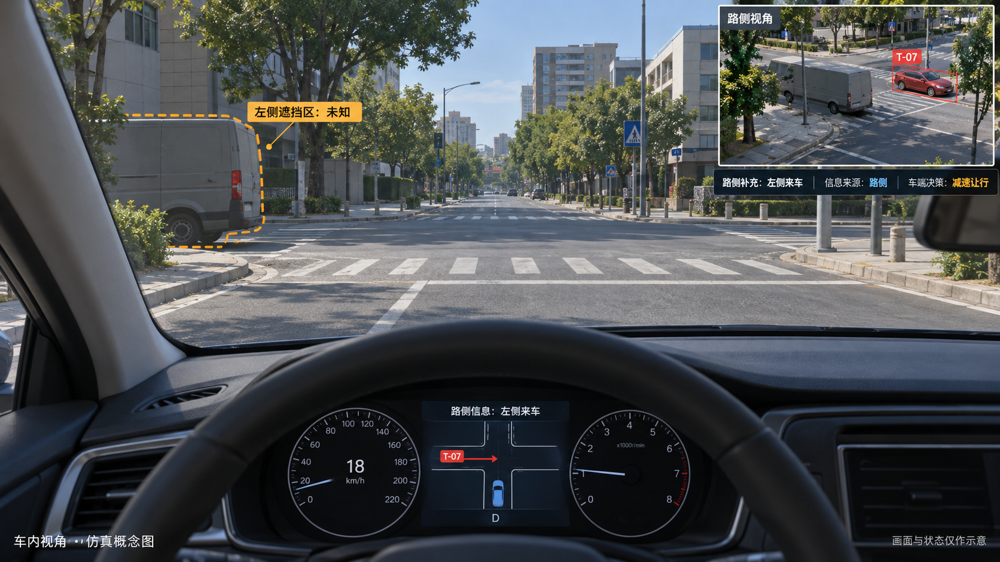
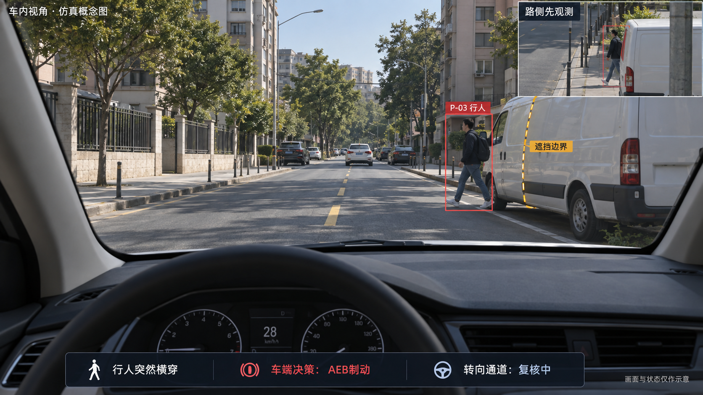
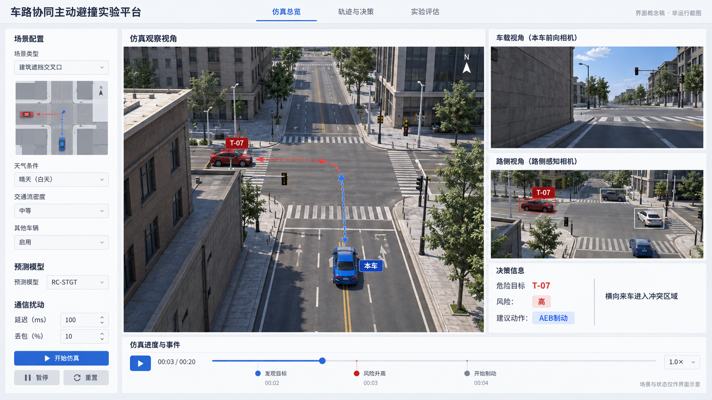
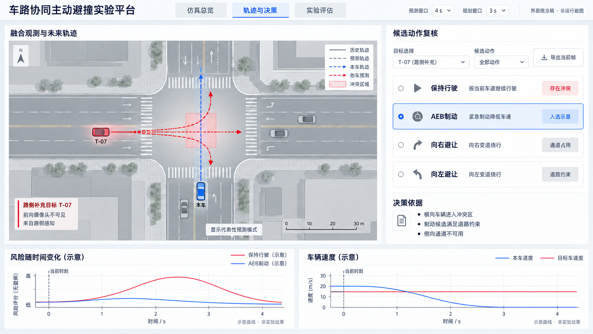
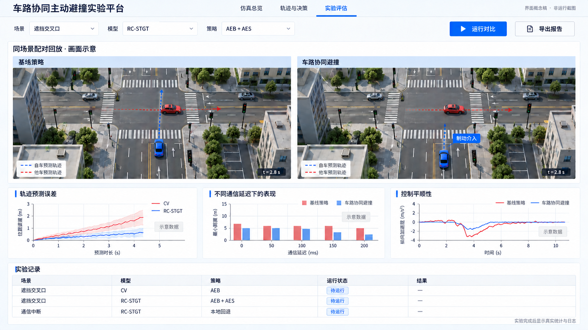

# 毕业设计最后成品：形态与界面效果图

版本：V1.1  
更新日期：2026年10月26日  
对应课题：基于 Transformer 的超视野车路协同主动避撞方案研究  
状态：成品设计与AI生成界面概念稿；当前尚未完成软件、训练或仿真闭环。

## 1 简单理解最后要交什么

最终核心成品为车路协同碰撞风险预测与主动避撞算法包，可无界面运行，最终风险复核、AEB/AES决策和控制位于车端。CARLA仿真负责验证与展示。主要视觉呈现改为车内驾驶视角的盲区来车、行人和骑行者鬼探头；原管理页面保留作辅助，详见[算法成品与盲区鬼探头方案](算法成品与盲区鬼探头方案.md)。

一套完整交付首先包含数据处理、模型训练与推理、盲区与鬼探头适配、风险、AEB/AES及控制接口和实际训练权重；配套CARLA场景/观察适配器、真实运行记录与统计、说明视频和论文。当前以无实车的算法验证为目标。

## 2 主要展示：车内视角

本车视野受遮挡，路侧补充目标，最终由车端决定减速让行。未知区域与确已观测目标分开显示。

行人从停放车旁突然横穿，算法进行短历史预测、风险复核和制动；转向必须验证侧向通道。两图均为AI生成概念示意，不是CARLA运行截图或实测效果。

## 3 三个辅助页面

| 页面 | 老师能看到什么 | 能做什么 |
| --- | --- | --- |
| 仿真总览 | 路口观察画面、车载和路侧两种视角、危险目标、当前动作、事件时间线 | 选场景/模型，设置通信扰动，开始、暂停、重置和回放 |
| 轨迹与决策 | 融合观测、目标历史、多种未来轨迹、动作比较、选择/拒绝原因、风险与速度曲线 | 切换目标和候选动作，查看预测如何影响制动或转向 |
| 实验评估 | 同场景策略配对回放、模型误差/通信鲁棒性/控制曲线、运行记录 | 按场景/模型/策略检索，对比运行结果，导出原始数据与报告 |

这些页面服务已有研究路线，不要求另做导航、地图搜索或真实车机产品。两车意图协同作为后续扩展，先完成单车避撞闭环。

## 4 原有管理界面概念图（辅助参考）

以下3张使用内置imagegen生成并做了视觉复核，采用白灰界面、蓝色本车、红色危险目标。图中道路、目标框、轨迹、曲线、风险状态和按钮均为概念展示。图片上的数值不是测得的性能指标，页面按钮目前不可交互；实际开发后由传感器、模型、控制器和运行日志驱动。生成图用于确认界面方向，不能直接充当系统运行截图或实验结果。

### 图1 仿真总览

中央看路口，右侧比较车载与路侧视角：本车看不到的目标，路侧能够补充。左侧调整场景和通信条件，底部定位“发现目标—风险升高—开始制动”等事件。

中央仿真观察视角可展示场景全貌；它属于观察/评测视图。控制器的输入仍限于当时可获得的本车状态、传感器和已到达消息，观察视图的全局真值不能借道进入控制。

### 图2 轨迹预测与避撞决策

展示危险目标可能的运动方向，以及本车保持、制动和侧向避让候选。界面解释为什么选中某个动作、为什么排除其他动作。风险比较必须对应同一目标场景与统一时间窗下的不同本车动作；示意风险评分不等于已经校准的碰撞概率。

速度曲线单独使用m/s轴。制动指令如后续加入，放在独立图或明确标注的独立轴中，避免混淆单位。图内代表性轨迹仅说明界面表达，正式轨迹由冻结模型输出与道路/时间约束决定。

### 图3 实验对比与记录

上方比较同场景下不同策略的表现，下方查看预测误差、通信条件和控制平顺性，并追溯每次实验的配置与日志。图中记录保持“待运行”；曲线和柱形明确标为“示意数据”。正式评测由实际日志生成，不预设哪个方法一定更好。

配对回放同步到同一仿真时间，核对初始条件、外车脚本和通信扰动。无响应外车在两次运行中的同一时刻保持相同状态，本车可因策略而改变；响应型交通需另行定义并报告。最终成品增加run_id、模型版本、种子和原始文件入口，使每张结果图可追踪。

## 5 答辩时的一段演示

1. 选择建筑遮挡交叉口，展示车载视角里的遮挡和路侧视角里的目标。
2. 启动仿真，显示目标历史、多模式预测和冲突区域。
3. 查看候选动作：保持行驶有冲突，侧向空间受限，系统选中制动；观察速度变化和车辆停在冲突区前。
4. 回放相同场景的基线策略与协同策略，解释干预时刻与实际结果。
5. 增加延迟或断联，检查消息失效与本地回退；在实验页查看真实记录。

这是演示目标脚本，具体结果由场景和算法实际运行决定。演示不保证每个场景避撞成功；失败案例和方法边界同样进入记录。

## 6 开发顺序与验收

先完成可无界面运行的CV→几何风险→AEB算法闭环，再接盲区、行人短历史、已训练Transformer、AES/MPC与通信扰动。车内观察、回放和检索通过独立适配器订阅真实输出，不能写死结果或替算法决策。

| 层次 | 设计目标 | 完成时的证据 |
| --- | --- | --- |
| 可运行 | 关闭图形界面后算法仍可计算并驱动仿真适配器 | 核心接口、启动命令、完整运行日志与车内视角视频 |
| 可解释 | 显示来源、采集/到达时间、动作风险和约束原因 | 同时间轴的观测、消息、预测与决策记录 |
| 可复核 | 结果来自可定位的一次实验 | run_id、配置、权重hash、种子、原始CSV与统计脚本 |

本次只完成概念图片和文档。图片已生成、逐张目视复核并保存；没有据此声称软件已实现、交互已测试或实验已完成。论文黑白流程图与这些界面概念图用途不同，分别保留。

## 7 原图与生成说明

- [3张效果图离线预览](figures/product_mockups_2026-10-26/index.html)
- [完整生成提示词、修订提示词与来源](figures/product_mockups_2026-10-26/生成提示词与来源.json)
- [图片尺寸与文件校验清单](figures/product_mockups_2026-10-26/manifest.json)
- 生成方式：内置image_gen工具，使用imagegen技能；未调用外部API脚本。
- 原始生成文件保持不变，选定版本复制进入项目。尺寸与格式检查不代表软件交互或算法验证。

- [新增2张车内视角原图](figures/driver_view_2026-10-26/index.html)
- [车内视角生成提示词与来源](figures/driver_view_2026-10-26/生成提示词与来源.json)
