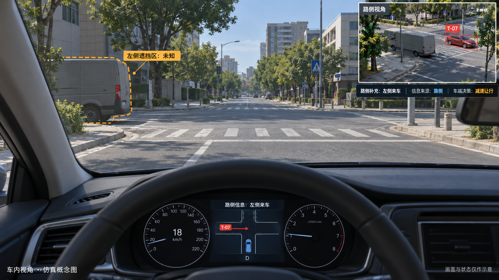
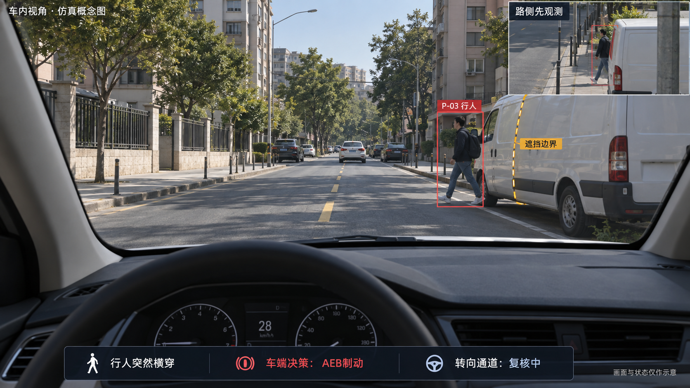

# 算法成品与盲区、鬼探头方案

版本：V1.0  
更新日期：2026年10月26日  
对应课题：基于 Transformer 的超视野车路协同主动避撞方案研究  
状态：算法交付与场景实施设计；图片为AI生成概念稿，尚未实现新增算法或运行仿真实验。

## 1 最终交付的核心是什么

最终成品确定为一套可运行、可评测、能接入车辆控制接口的“车路协同超视野碰撞风险预测与主动避撞算法”。训练代码、实际训练权重、推理与决策接口、配置、测试和实验记录共同构成算法交付。CARLA提供传感器、交通场景、车辆动力学和评测；车内视角用于展示算法的感知、判断和行动，辅助管理页面用于实验检索。

核心验收是算法能够脱离可视化界面运行，相同输入与冻结配置下输出可追踪的决策；界面关闭后算法仍能完成闭环。当前讨论明确成品目标，并不表示算法已经实现。

## 2 最终决策在哪里计算

| 位置 | 拟运行内容 | 输出或权限 |
| --- | --- | --- |
| 训练服务器 | 数据处理、模型训练、离线评估与校准 | 冻结权重、配置、数据划分和训练记录 |
| 路侧边缘计算 RoadsideEdge | 摄像头检测/跟踪、米制定位、跨来源关联、协同Transformer预测 | 带采集时间、来源、质量和有效期的目标/预测消息 |
| 车端辅助驾驶计算单元 VehicleAgent | 本地感知、消息有效性检查、盲区状态、候选动作风险、AEB/AES选择、MPC与回退 | 本车最终动作、控制请求、执行有效期与原因 |
| 仿真与观察层 | 交通参与者运动、传感器生成、执行、评测、车内/路侧视角与日志 | 按算法请求推进车辆，不替算法决定动作 |

用户所说的“车机进行最终计算”在论文中写为“车端辅助驾驶计算单元与控制器进行最终决策和控制”。显示屏呈现结果；实际量产硬件接入不属于当前无实车阶段的已实现成果。路侧可以计算预测和风险提示，车端仍需按本车动作、最新状态和可行空间复核。

仿真阶段这些模块可以同机运行，但通过输入协议隔离。训练服务器性能高，不代表已经测得车端实时性能；按目标数、输入分辨率、实际硬件分别报告耗时和超时率。

## 3 算法包的接口与组成

拟建接口（不是当前已有代码）：

~~~text
VehicleDecisionCore.step(
    now, ego_state, local_tracks, arrived_roadside_messages,
    known_map, visibility_state, health, frozen_config
) -> DecisionBundle
~~~

输入只包含本车合法可得状态、截至当前已可用的本地观测与路侧消息、已知地图、观测质量和健康状态。禁止把CARLA全局World句柄、隐藏目标真值、未来帧或未来控制结果传入核心接口。

DecisionBundle至少包含：

- 危险目标ID、类别、信息来源、原始观测时间和不确定性。
- 盲区/未知区域及其依据，与已观测目标分开存储。
- 本车候选动作、各自动作条件风险、有效共同预测窗口、约束通过/拒绝原因。
- 现有Normal/Caution/AEB/AES/Degraded/Recovery状态，以及组合制动转向或减损标记。
- 本车参考轨迹、加速度/转角等控制请求、预计执行起点、有效期和算法/配置版本。

风险输出注明risk_kind：经过验证的事件概率、未校准评分或未知遮挡区保守指标。三种口径不混称“碰撞概率”。算法规划起步10Hz，底层控制20Hz；频率需实际耗时和控制标定后冻结。

建议算法包包含core接口、感知/融合/预测/风险/规划/控制模块、训练与推理入口、配置和权重、独立CARLA适配器、离线回放评测器及可选观察界面。图形界面不能直接替代风险与规划模块生成最终控制。

## 4 “盲区检测”需要实现哪两层

### 4.1 识别被遮挡或无法确认的区域

起步采用地面网格、相机视场与射线遮挡计算。0.25～0.5米网格可作联调配置：用已知地图的建筑边界与当前可观测遮挡物的估计轮廓，在视场内以Bresenham等网格射线遍历，射线碰到遮挡物后的区域标记为遮挡；视场外和几何/感知质量不足区域标记未知。

这是本课题拟实施的平面几何近似，不是已验证的三维可见性算法。动态遮挡物尺寸来自观测估计及明确的车型先验，不能读取隐藏真值轮廓；高低差、障碍物高度、低照和检测分辨率另设边界。几何上可视不等于区域内每个目标都能被检测，更不等于已经确认区域为空。

输出VisibilityGrid和OcclusionRiskRegion，至少保存区域、来源、参考时间、几何可视/遮挡/未知状态及质量。未知区域保持不确定，不能填成安全可通行区域。

### 4.2 利用路侧补充盲区内的目标

车端当前未观测到、路侧实际观测到且消息有效的目标，可以作为roadside_only轨迹进入预测和风险评估。保留来源与采集时间，消息过期后扩大不确定性或退回未知状态，不能让过期目标静默消失。

双方都未看到目标时，只能根据遮挡边界、可能的闯入路径与有限速度/加速度假设构造潜在可达区域，采取谨慎减速等策略。它属于区域风险约束，不能凭空生成位置精确的“隐藏行人检测框”，也不能随意赋予校准概率。

区域可达性联调可以从沿路缘/出口的一组潜在起点出发，按类别速度范围和时间扩张；范围参数需验证，须同时统计无人出现时的误干预与通行效率。

## 5 “鬼探头”成为必做场景

本次将鬼探头明确解释为行人或骑行者从停放车、大车或建筑遮挡后突然横穿。至少包括：

| 场景 | 可用信息 | 算法目标 |
| --- | --- | --- |
| 路侧提前看到，车端被挡 | 有时间标记的路侧目标历史 | 提前预测闯入并在车端制动/可行避让 |
| 车路同时被挡，目标突然露出 | 遮挡区域；露出后才有短历史观测 | 事先谨慎减速，出现后快速跟踪与紧急响应 |
| 只有遮挡物，无人出现 | 未知区域，没有真实目标 | 控制误干预，不能每次都紧急制动 |
| 骑行者突然横穿 | 类型、运动状态和短历史 | 按骑行者速度/尺寸预测，不套汽车运动假设 |
| 避让方向已有车辆或行人 | 主车全部有效观测 | 排除二次碰撞与越界候选 |
| 路侧消息过期、断联 | 本地观测与有限风险记忆 | 正确降级并报告残余风险 |

每类都需要可及时制动与已经缺乏足够反应距离的不同初始条件，分别评估避撞与减损；不以所有场景零碰撞作为预先保证。

## 6 具体算法怎样扩展

| 环节 | 拟采用方法 | 必须增加的实现 |
| --- | --- | --- |
| 检测与跟踪 | 统一比较YOLO26、YOLOv8、YOLO11等检测器，结果决定选型，再接ByteTrack | 加入person/bicycle/motorcycle及车辆类别，按类别评测；骑行者需关联人和两轮车并避免重复计数 |
| 地面定位 | 固定相机DLT/RANSAC、移动车载相机射线地面求交 | 区分行人脚点、两轮车接地点、汽车接地点，分别评估遮挡下误差 |
| 状态与关联 | CV Kalman、Mahalanobis门控、最小代价分配 | 保存类别和质量，突发目标不补造历史，关联歧义显式保留 |
| 多模态预测 | RC-STGT来源/年龄融合、时间/交互注意力 | 增加agent_type嵌入；行人地图上下文包含人行道、路缘和横道，也保留非横道横穿可能 |
| 短历史兜底 | 因果CV/Kalman与类型相关可达区域 | 历史不足20点仍按mask输入；不等待凑齐2秒才开始AEB，短历史置信低时扩大运动覆盖 |
| 碰撞几何 | 车辆OBB-SAT；行人与车辆的矩形-圆距离；两轮车OBB/胶囊近似 | 各类别尺寸/裕量独立；保留时间区间细分，不能只检查离散时刻 |
| 动作与执行 | 候选保持/制动/转向/组合，约束筛选 + MPC/PID | 全部在车端复核；AES同时考虑所有可观测车辆与行人、道路边界和附着约束 |

最终检测器按[技术路线](详细技术路线.md)第21.2.1节统一比较，至少包含YOLO26、YOLOv8、YOLO11，必要时扩展其他模型；依据逐类别/小目标召回、跟踪连续性、时延与配对闭环结果选择，不预设任何版本更好。当前尚未执行对比，原YOLO11m代码仅为接入示例。

COCO官方类别说明包含person、bicycle及车辆等类别，见[Ultralytics官方文档](https://docs.ultralytics.com/datasets/detect/coco/)。这只支持设置检测类别，不能证明仿真视角检测效果或骑行者关联已经达标。

加入行人后，原车辆训练权重不能直接视作行人模型。先审计真实数据类别覆盖；不足时用独立CARLA行人数据训练和评测，冻结场景划分。车辆与行人/骑行者分别报告预测、风险校准和闭环结果。行人可停下、突然起步、改变方向，不能被车辆非完整动力学或硬车道掩码限制。

本车仍采用六状态自行车模型。行人圆形近似的几何检查可先用如下参考公式：将行人中心变换到本车OBB中心局部坐标(p_x,p_y)，本车半长/半宽为h_l、h_w，行人半径及裕量之和为r；令d_x=max(|p_x|-h_l,0)、d_y=max(|p_y|-h_w,0)，若d_x²+d_y²≤r²则相交。本车由后轴参考点先转换至车体中心，圆形近似和半径需独立评估。该公式定义平面几何事件，不是伤害预测模型。

## 7 车内视角怎样实现与显示

使用车辆附着RGB相机，driver_camera位于经车型验证的驾驶员眼点，front_camera为算法实际使用的前向相机。二者若位置不同，分别记录内外参、视场、采集时间和可见性；不能用“驾驶员看不见”代替“所有车载感知都看不见”的超视野证据。

CARLA提供sensor.camera.rgb及attach_to、相对Transform；据此可实现随车固定视点，接口依据见[官方传感器教程](https://carla.readthedocs.io/en/0.9.15/core_sensors/)。驾驶员眼点位置属于车型相关工程设置，不能把某组坐标当作通用值。方向盘和座舱是否真实可见取决于蓝图、材质和相机位置，必须实际渲染确认；相机附着不自动生成完整内饰。

车内展示以挡风玻璃道路画面为主，叠加稀疏调试标注：可见目标使用检测框；路侧独有目标使用“来源：路侧”的方向/小地图提示；未知遮挡区使用区域提示。显示车端选中动作与原因，避免让人以为显示屏负责避撞计算。界面标注不作为已经实现量产AR-HUD的宣称。

### 图1 车内视角：盲区来车

本车视点被厢式车挡住，主画面不画穿透遮挡物的实体目标框；路侧小窗提供另一视角的目标信息，车端决定减速让行。仪表速度、目标位置与状态均为生成示意。

### 图2 车内视角：行人鬼探头

行人露出后主画面出现检测框，路侧小窗说明提前观测来源，车端做AEB并继续复核侧向空间。正式实现中，若小窗显示历史帧，必须标注采集时间及“历史”；需要同步比较可见性时使用同一绝对时刻。画面不代表真实停车距离、制动效果或实验结果。

## 8 如何构造和测试

CARLA鬼探头起步采用固定行人蓝图、出生点、停放厢式车和逐帧WalkerControl脚本。direction使用世界坐标、speed按m/s设置；在指定仿真帧开始横穿，后续按冻结计划控制，依据见[CARLA WalkerControl官方API](https://carla.readthedocs.io/en/0.9.15/python_api/#carla.WalkerControl)。实际轨迹和重复运行偏差需核查，固定脚本不等于天然完全确定。

使用已有0.05秒同步步长和唯一tick调度器，保持地图、天气、初始化和外部交通脚本一致，相关条件见[官方同步说明](https://carla.readthedocs.io/en/0.9.15/adv_synchrony_timestep/)。车辆和行人真值只给标注/评测器，不能直接给感知与控制接口。

新增检查与原53项待实施规格分开维护，不将交叉项简单累计为通过数量：

| 编号 | 输入/操作 | 期望断言与产物 |
| --- | --- | --- |
| B01 脱离界面运行 | 相同输入分别开/关观察界面 | DecisionBundle及控制一致；保存接口日志与输入hash |
| B02 遮挡网格与因果 | 固定已知墙体和观测；改变未观测隐藏行人或未来轨迹 | 核心当前输入/输出不随隐藏真值改变；保存visibility_audit.json |
| B03 路侧独有目标 | 本地无目标，路侧有有效消息；再令消息过期 | 有效时保留roadside_only与时间，过期后正确降级；不冒充本地检测 |
| B04 突发短历史 | 行人只有1～3次观测、存在漏检 | 历史mask诚实；风险/回退可运行且无NaN；不伪造20点历史 |
| B05 类型与几何 | 汽车OBB、行人圆、两轮车近似及边界相切/高速穿越 | 使用对应尺寸与参考点，检查区间碰撞；保存geometry_by_type.json |
| B06 鬼探头与无人对照 | 左右遮挡、行人/骑行者横穿、无人出现，配对速度与触发计划 | 分别报告碰撞、碰撞速度、漏报和误干预；不只选成功视频 |
| B07 转向空间与异常 | 侧向有行人/车、地图边界、消息断联或求解失败 | 不使用不满足硬约束候选；回退可追踪，仍报告实际残余事件 |
| B08 车内视点/采集视点 | 固定driver_camera与front_camera相对位姿和同刻图像 | 展示相机不替代感知证据；座舱可见性与框投影另行实测 |

每次保存车端首次几何可见（评测用）、车端首次实际检测、路侧首次检测、消息在车端可用、预警、制动请求与实际制动时刻。比较首次有效预警提前量、实际碰撞/碰撞速度、最小间距、误干预、jerk及AES约束；漏报单列，不能只统计成功预警。

## 9 本次产物与后续入口

- 本次完成算法核心定位、车端决策契约、盲区/鬼探头方案、2张车内视角概念图与文档更新。
- 算法实现、检测训练、行人预测训练、车内相机渲染和CARLA闭环均待实施；既有参考函数检查不作为新增功能已通过的证据。
- 原3张管理界面图继续保留作辅助展示参考，论文黑白流程图另行保留。后续先实现无界面CV→风险→AEB算法闭环，再接入可靠性Transformer与AES/MPC。
- 两张车内视角原图直接见本文的概念图说明，不再维护独立HTML预览副本。
- [内置imagegen完整生成提示词与来源](figures/driver_view_2026-10-26/生成提示词与来源.json)
