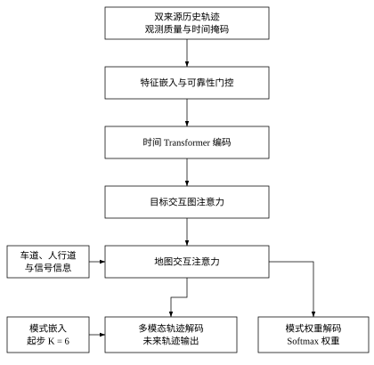

# 论文用黑白流程图集

版本：V3.0

更新日期：2026年10月29日

本版按论文插图重绘：黑白、统一0.75 pt线宽、10.5 pt宋体与Times New Roman、正交连线。图片内只保留流程本体；图题、参数说明和研究状态在正文中交代。各图实际宽148.17 mm，插入论文时按该宽度使用。

[全部可编辑图（draw.io）](figures/flowcharts_paper_2026-10-26/论文流程图.drawio)

图集依据当前[研究方案](毕业设计研究方案.md)、[技术路线](详细技术路线.md)、[车路通信方案](车路通信方案.md)和[节点计划](项目节点实施与验收计划.md)更新，表达的是拟实施设计，不代表已经训练模型、运行CARLA闭环或测试真实通信设备。统一图源和再生成方法见[图集生成说明](figures/flowcharts_paper_2026-10-26/README.md)。

主链中，I端根据合法观测提供目标状态及预测轨迹；V端检查可用时刻和预测覆盖，结合本地观测进行最终风险判断、动作决策和控制。检测器至少比较YOLO26、YOLOv8和YOLO11，按本项目实测选择；双方都未观测到目标时只表达未知区域与谨慎策略，不伪造目标。

## 图 1 系统总体技术路线

图 1　系统总体技术路线

TFD用于真实轨迹预测，SPD用于真实图像感知及预测验证，CARLA用于交互闭环；各数据域分别审计与划分，不默认逐帧配对。训练和模型验证与独立风险校准分开；路侧提供目标状态及预测，车端做最终风险判断和控制。

[SVG 矢量图](figures/flowcharts_paper_2026-10-26/images/01_总体技术路线.svg)

## 图 2 车路协同感知与信息交互流程

图 2　车路协同感知与信息交互流程

车端和路侧使用统一适配的检测器及ByteTrack完成检测跟踪与定位；至少比较YOLO26、YOLOv8、YOLO11，依据项目实测选择。V2I上传合法观测，路侧融合并通过I2V提供目标状态及多模式预测，车端校验可用时刻和覆盖后独立判断风险并控制。状态或预测缺失按既有设计降级，未观测目标不能凭空补造。

[SVG 矢量图](figures/flowcharts_paper_2026-10-26/images/02_车路协同感知.svg)

## 图 3 RC-STGT 轨迹预测模型结构

图 3　RC-STGT 轨迹预测模型结构

来源门控融合合法可用的车端与路侧历史，依次编码时间、交通参与者交互及地图信息。轨迹解码器使用模式嵌入，权重分支读取融合特征；模式权重不等于已校准的碰撞概率，未来真值只供离线训练监督。

[SVG 矢量图](figures/flowcharts_paper_2026-10-26/images/03_轨迹预测模型.svg)

## 图 4 碰撞风险评估与主动避撞决策流程

图 4　碰撞风险评估与主动避撞决策流程

车端检查本车状态及可用路侧目标状态、预测时效和覆盖，生成并筛选候选动作；按车辆、行人及骑行者使用不同几何和区间检查，保留未知区约束。原始评分与适用校准概率分开，覆盖不足或无可行候选时执行经复核的谨慎或减损策略。

[SVG 矢量图](figures/flowcharts_paper_2026-10-26/images/04_风险评估与避撞决策.svg)

## 图 5 MPC 车辆控制与失效回退流程

图 5　MPC 车辆控制与失效回退流程

候选动作由车端筛选后，MPC以六状态自行车模型和RK4跟踪参考；时域3秒、步长0.1秒及10Hz／20Hz为待验证配置。求解必须非阻塞，超时、无解或安全复核失败时，对回退轨迹再次复核并按实际可行性减损。

[SVG 矢量图](figures/flowcharts_paper_2026-10-26/images/05_预测控制与执行.svg)

## 图 6 实验测试与研究验证流程

图 6　实验测试与研究验证流程

先检查模块与因果接口，使用TFD轨迹、SPD真实图像及CARLA开发与验证数据完成选型；冻结配置和协议后再开展独立正式测试。按场景统计配对结果并保留失败、缺失和分母，不把仿真结果写成实车效果。

[SVG 矢量图](figures/flowcharts_paper_2026-10-26/images/06_实验与测试.svg)

## 插入论文与修改

- 优先使用SVG，以148.17 mm宽度插入；图内文字为10.5 pt。图题按论文模板放在图外，最终尺寸、分页和字体须按学校实际版式检查。
- 可用上方合并draw.io编辑全部6张图；需要PNG时按用途临时导出，不把重复预览纳入仓库。
- 修改节点或连线后，应更新`source/figures.json`并按生成说明同步SVG、draw.io和SHA-256清单，避免图源与导出不一致。
- 图中模式数、周期及时域属于待验证配置；数据可用性、真实训练、控制效果和节点状态以实际结果为准。
