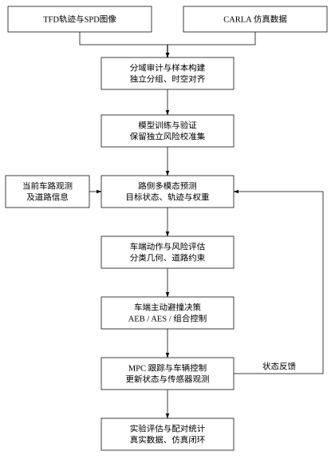
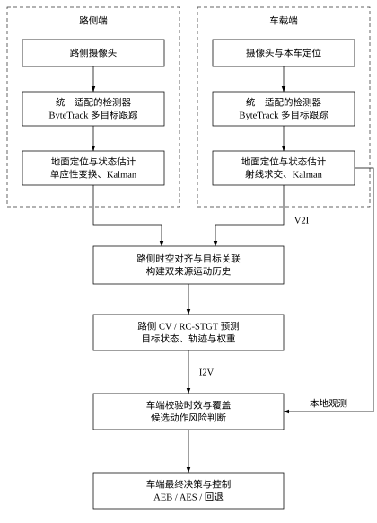
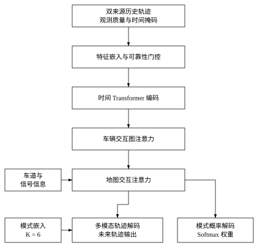
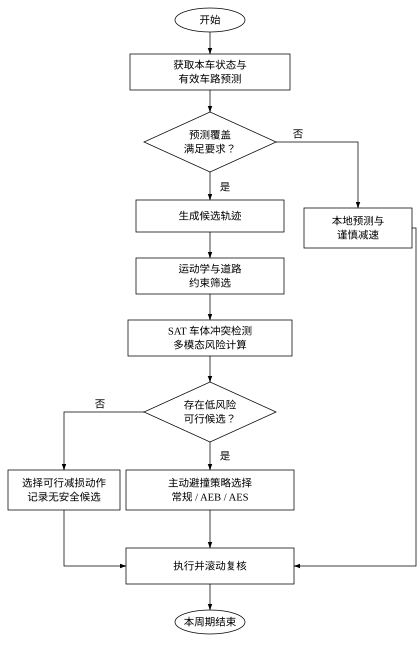
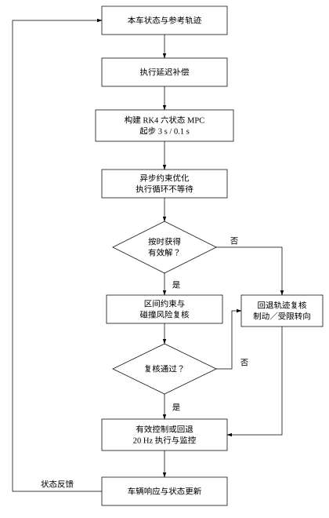
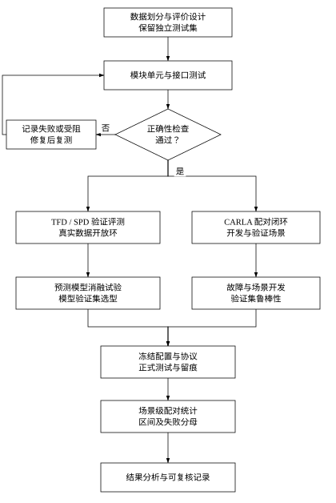

# 论文用黑白流程图集

版本：V2.0  
更新日期：2026年10月26日

本版按论文插图重绘：黑白、统一0.75 pt线宽、10.5 pt宋体与Times New Roman、正交连线。图片内只保留流程本体；图题、参数说明和研究状态在正文中交代。各图实际宽148.17 mm，插入论文时按该宽度使用。

[全部可编辑图（draw.io）](figures/flowcharts_paper_2026-10-26/论文流程图.drawio)

资料版本说明：图源依据主方案 V1.0、技术路线 V1.2 绘制，后续行人/骑行者与鬼探头要求见 [算法成品方案](算法成品与盲区鬼探头方案.md)。本轮保留既有图像与图源；论文定稿前应按实际实现同步图源。再生成依赖与命令见 [图集生成说明](figures/flowcharts_paper_2026-10-26/README.md)。

## 图 1 系统总体技术路线

图 1　系统总体技术路线

公开轨迹和仿真数据经过预处理构建训练样本。冻结预测模型后，系统结合当前观测进行轨迹预测、风险评估和主动避撞，并通过闭环仿真评估。状态反馈只回到在线预测阶段。

[SVG 矢量图](figures/flowcharts_paper_2026-10-26/images/01_overall.svg)

## 图 2 车路协同感知与信息交互流程

图 2　车路协同感知与信息交互流程

车端和路端分别完成目标检测、跟踪及米制状态估计。车端通过V2I上传观测，路侧完成关联与预测后通过I2V下发，最终风险复核和控制由车端完成。失联回退见决策流程。

[SVG 矢量图](figures/flowcharts_paper_2026-10-26/images/02_cooperative_perception.svg)

## 图 3 RC-STGT 轨迹预测模型结构

图 3　RC-STGT 轨迹预测模型结构

来源门控融合车端与路端历史，依次编码时间、车辆交互和地图信息。轨迹解码器接收模式嵌入，模式概率分支直接读取融合特征。未来真值仅用于训练损失，未进入该推理结构。

[SVG 矢量图](figures/flowcharts_paper_2026-10-26/images/03_transformer.svg)

## 图 4 碰撞风险评估与主动避撞决策流程

图 4　碰撞风险评估与主动避撞决策流程

先检查预测信息覆盖，再生成并筛选可执行候选，使用SAT与多模态权重评估冲突。AES仅在侧向通道可观察、道路和动力学约束均可行时参与选择；无低风险候选时执行减损控制。

[SVG 矢量图](figures/flowcharts_paper_2026-10-26/images/04_risk_decision.svg)

## 图 5 MPC 车辆控制与失效回退流程

图 5　MPC 车辆控制与失效回退流程

以六状态自行车模型和RK4离散构建非线性MPC。求解时域3s、步长0.1s，外层10Hz优化，20Hz执行与监控。解需在截止前返回并经过区间复核，否则执行经复核的平稳回退。

[SVG 矢量图](figures/flowcharts_paper_2026-10-26/images/05_mpc.svg)

## 图 6 实验测试与研究验证流程

图 6　实验测试与研究验证流程

先完成模块与接口正确性检查，再分别进行真实轨迹开放环和CARLA闭环评测。配对实验、消融、鲁棒性和泛化结果按场景统计；此流程表示待执行的实验协议。

[SVG 矢量图](figures/flowcharts_paper_2026-10-26/images/06_testing.svg)

## 插入论文与修改

- 优先使用SVG，以148.17 mm宽度插入；图内字体等效10.5 pt。图题由论文模板在图外排版。
- 需要编辑时打开上方合并draw.io文件；如编辑器需要PNG，按实际插入尺寸临时导出，不重复入库。
- 参数、试验状态与模型定义以技术路线正文为准；本图集表示拟实施设计，不增加训练或仿真结果。
- 再生成：运行render.cjs。source/figures.json保存节点位置及连线，可通过FLOWCHART_NODE_MODULES指定sharp依赖目录。

## 版本记录

2026年10月26日：保留6张黑白SVG、统一JSON图源和合并draw.io，删除重复PNG/预览、逐图draw.io与重复页面。SVG原文未改动，旧版文件可从Git查看；本次不新增算法或实验结果。
